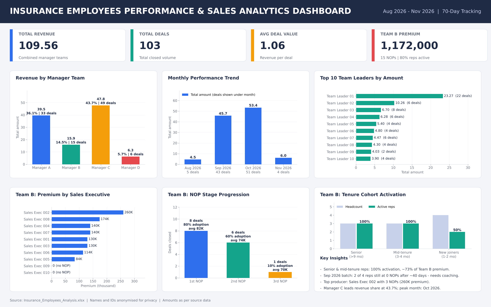

# Insurance Employees Performance Analysis

A Microsoft Excel dashboard project that analyses the sales performance of an insurance sales organisation across four manager teams, their team leaders and sales executives.

## Objective
Help sales leadership identify top-performing teams and leaders, understand revenue share and monthly trends, and spot onboarding gaps among new sales executives.

## Dataset
- **Period:** Aug 2026 – Nov 2026 (70+ tracking days)
- **Whole_Team:** daily deal log for 4 manager teams (121 records)
- **Team_B:** executive-level NOP tracker for one team (10 sales executives)
- **Privacy:** all names (managers, team leaders, sales executives) and employee IDs are anonymised.

## Key Metrics
| Metric | Value |
|---|---|
| Total Revenue | 109.56 |
| Total Deals | 103 |
| Average Deal Value | 1.06 |
| Team B Premium | 1,172,000 (15 NOPs) |
| Team B Active Rep Ratio | 80% |

## Key Insights
1. Manager C leads with 43.7% revenue share; Managers C and A together produce about 80% of revenue.
2. Manager A has the highest average deal size (1.20), while Manager C wins on volume.
3. October 2026 is the peak month: 53.36 from 51 deals (+16.8% vs September).
4. The top 13 team leaders generate about 76% of total revenue.
5. In Team B, rep adoption falls from 80% (1st NOP) to 10% (3rd NOP), and 2 of 4 reps from the September batch have 0 NOPs.

## Excel Skills Used
SUM, SUMIF / SUMIFS, COUNT / COUNTIF / COUNTIFS, INDEX + MATCH, RANK, IFERROR, array formulas, MoM growth, KPI cards, dashboard formatting.

## Files
| File | Description |
|---|---|
| `Insurance_Employees_Analysis.xlsx` | Excel workbook with data sheets and two dashboard sheets |
| `Insurance_Employees_Analysis_Dashboard.png` | Dashboard snapshot |
| `Insurance_Employees_Analysis_Report.pdf` | 15-slide analytics report |

## Note
August and November 2026 are partial months (3 and 7 tracking days), so month-on-month growth involving them should be read with caution.

---
**Presented by Asrarul Haque**
