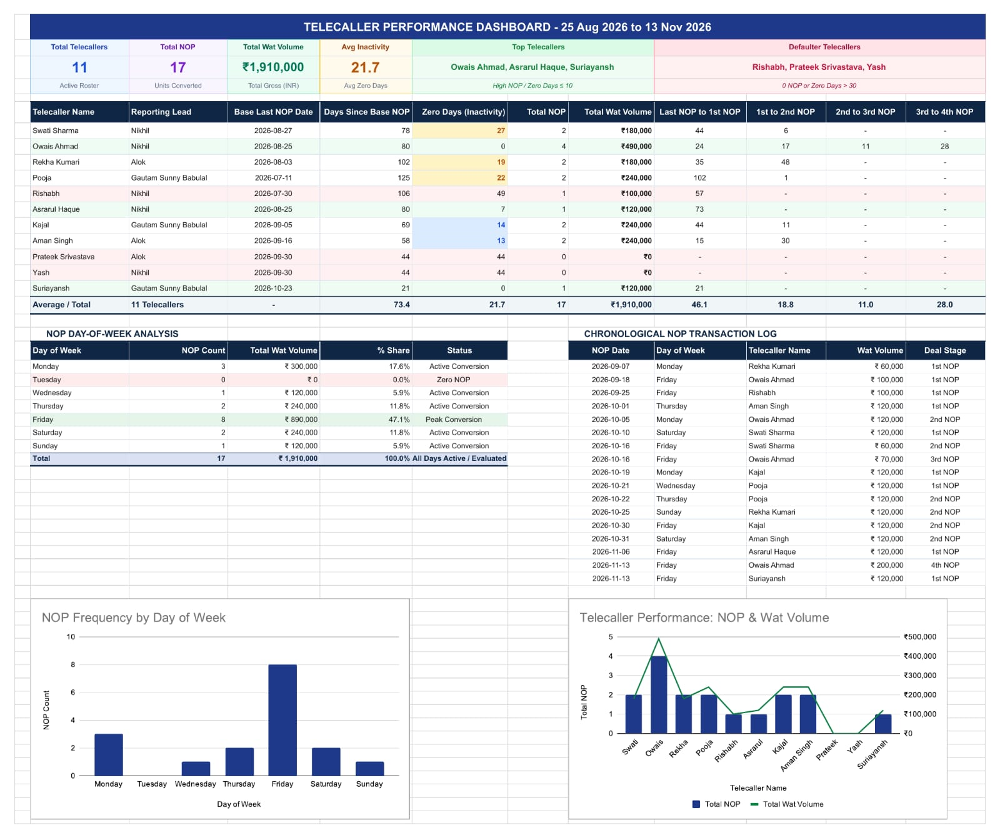

# Telecaller Performance Dashboard

A Microsoft Excel dashboard that analyzes telecaller performance for **Imran Ahamad's team** from **25 Aug 2026 to 13 Nov 2026**: NOP conversions, Wat volume, inactivity (zero days), top performers, defaulters, and conversion speed.

Presented by **Asrarul Haque**

---

## Repository Contents

| # | File | Description |
|---|------|-------------|
| 1 | [`01_Telecaller_Performance_Dashboard_Presentation.pdf`](01_Telecaller_Performance_Dashboard_Presentation.pdf) | 16-slide project presentation (objective, method, insights, recommendations) |
| 2 | [`02_Telecaller_Analysis_Dashboard.png`](02_Telecaller_Analysis_Dashboard.png) | Snapshot image of the Excel analysis dashboard |
| 3 | [`03_Telecaller_Emp_Performance.xlsx`](03_Telecaller_Emp_Performance.xlsx) | Excel workbook with the MIS data and the live dashboard |
| 4 | `README.md` | Project documentation (this file) |

---

## Dashboard Preview

---

## Project Objective

Give leads and management one clear view of who is delivering and who needs support, by answering:

1. How many NOPs and how much Wat volume did each telecaller close?
2. Who are the top performers?
3. Who are the defaulters (0 NOP or more than 30 inactive days)?
4. How many zero days (inactivity) does each telecaller have?
5. How fast do telecallers convert between 1st, 2nd, 3rd and 4th NOP?
6. Which weekdays bring the most NOPs and volume?

---

## Workbook Structure

| Sheet | Purpose |
|-------|---------|
| `Imran_Team` | Raw MIS data: login ID, name, DOJ, reporting leads, last NOP date, NOP 1 to 4 dates and Wat values, total NOP, total Wat, MIS date, last pickup date, zero days |
| `Analysis_Dashboard` | KPI strip, telecaller roster table, top and defaulter lists, day-of-week analysis, chronological NOP log, two charts |

### Key Logic

| Metric | Rule |
|--------|------|
| Total NOP | Count of filled NOP Wat cells (1st to 4th) |
| Zero Days | MIS Date − Last Pickup Date |
| Top Telecaller | NOP ≥ 3, or Zero Days ≤ 7 with at least 1 NOP |
| Defaulter | NOP = 0, or Zero Days > 30 |

### Excel Features Used

Formulas (`COUNTA`, `SUM`, `AVERAGE`), `TEXTJOIN` + `FILTER`, `IFERROR`, date calculations, conditional formatting, column chart, combo chart (NOP + Wat volume), day-of-week analysis, cell linking, dashboard formatting.

---

## Key Results

| KPI | Value |
|-----|-------|
| Total Telecallers | 11 |
| Total NOP | 17 |
| Total Wat Volume | ₹1,910,000 |
| Average Inactivity | 21.7 zero days |
| Top Telecaller | Owais Ahmad (4 NOPs, ₹490,000) |
| Top Telecallers list | Owais Ahmad, Asrarul Haque, Suriayansh |
| Defaulters | Rishabh, Prateek Srivastava, Yash |

### Key Insights

- 11 telecallers closed 17 NOPs worth ₹1,910,000 in the period.
- Friday delivers 47.1% of Wat volume (8 of 17 NOPs); Tuesday has no NOPs.
- Gautam Sunny Babulal's team converts the most per telecaller (₹200,000) with the lowest average inactivity (12.0 days).
- The first NOP takes 46.1 days on average; the second follows in 18.8 days.
- 3 of 11 telecallers are defaulters; two of them (Prateek Srivastava, Yash) have 0 NOPs.

### Recommendations

1. Run a re-activation plan for telecallers inactive for 30+ days.
2. Pair new joiners with top performers.
3. Find out why Tuesday has zero NOPs and copy what works on Fridays.
4. Set first-30-day targets to shorten the wait for the first NOP.
5. Share the best-performing team's practices with other teams.
6. Review zero days weekly and use this dashboard in team reviews.

---

## How to Use

1. Download `03_Telecaller_Emp_Performance.xlsx`.
2. Open it in Microsoft Excel.
3. Update the `Imran_Team` sheet with new MIS data (NOP dates, Wat values, MIS date, last pickup date).
4. The `Analysis_Dashboard` sheet recalculates automatically.

---

## Future Improvements

- Call and connect-rate analysis
- Target vs achievement tracking
- Week-over-week and month-wise trends
- Product-wise NOP analysis
- Power Query automation
- VBA refresh button

---

## Author

**Asrarul Haque**
